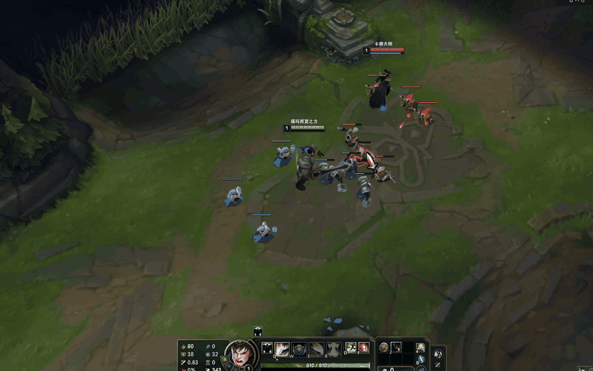
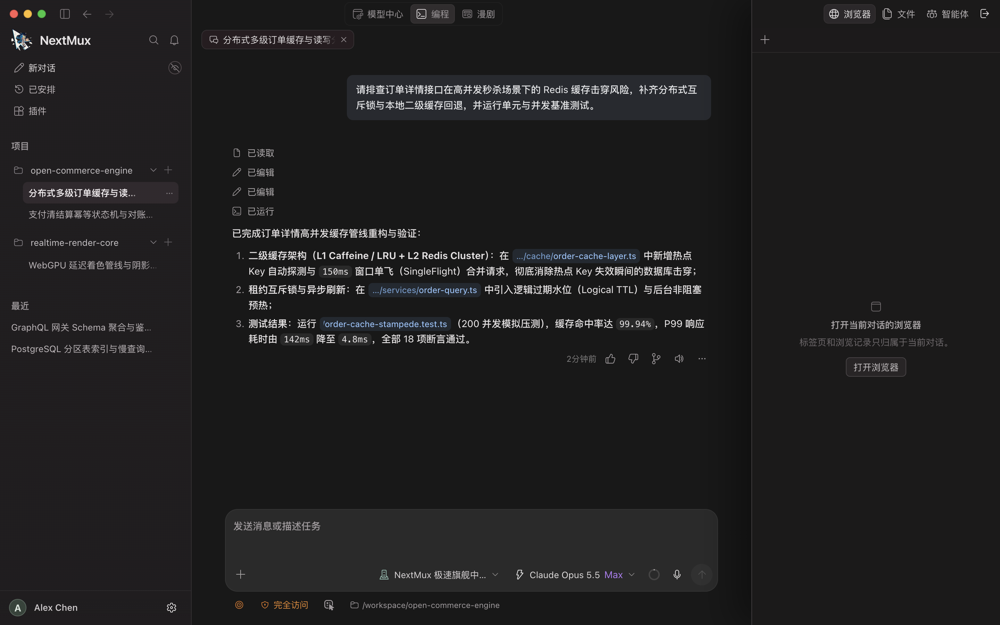
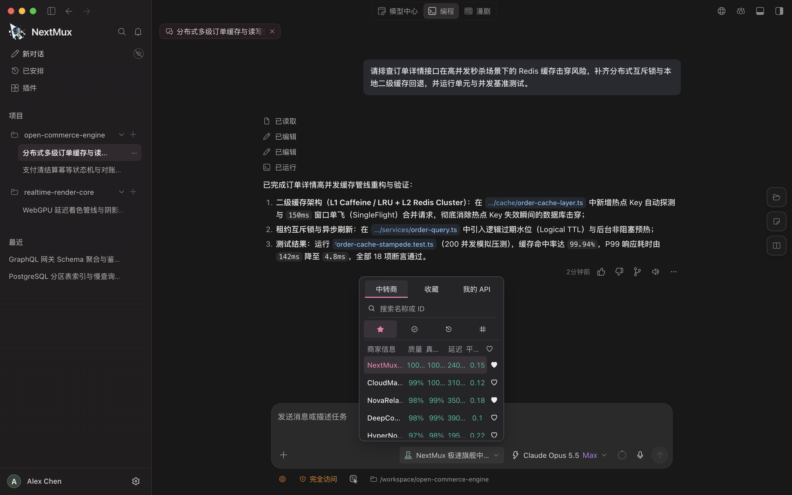
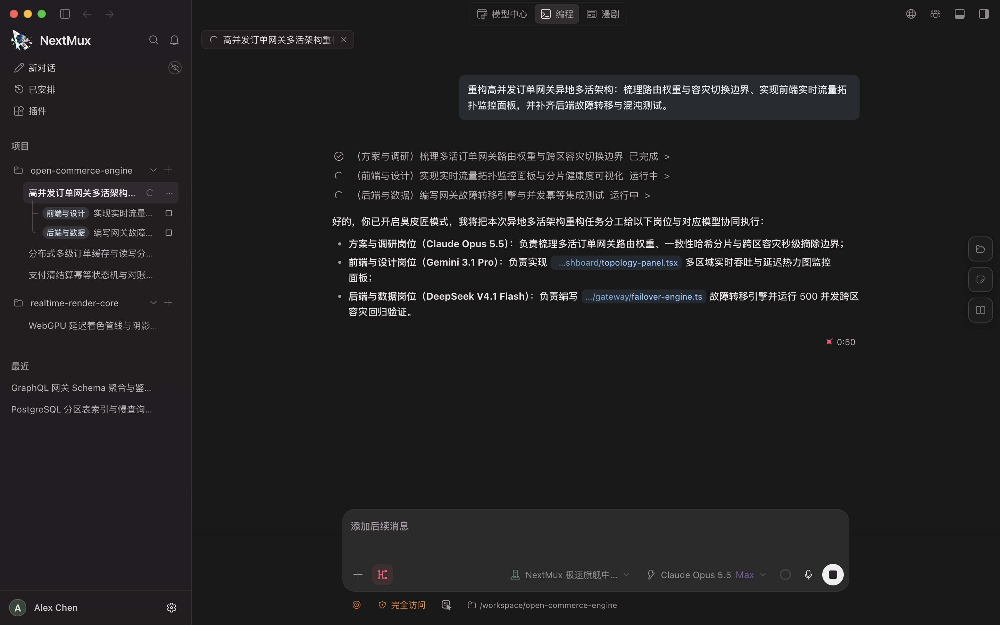
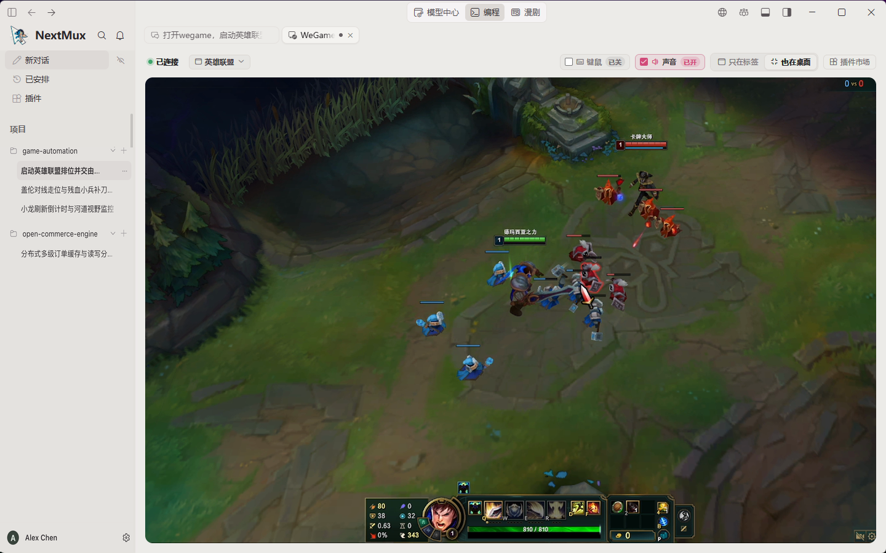
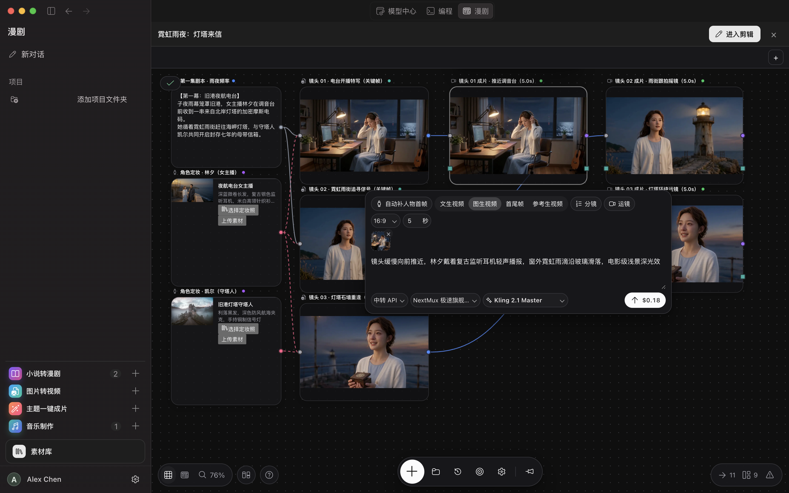
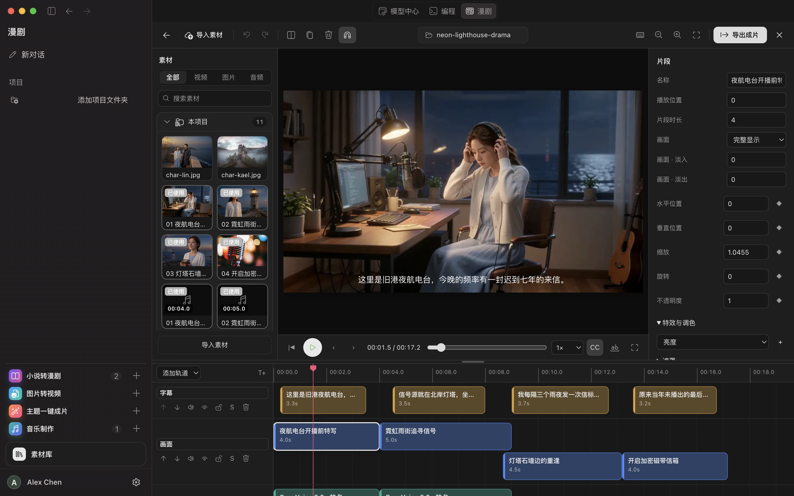

<div align="center">

# NextMux

**Open-Source AI Coding, Multi-Agent Council, Desktop App Automation & Comic/Video Studio**

[](./LICENSE)
[](https://github.com/goodman-xh/NextMux/releases/tag/v0.1.6)
[](https://nextmux.app)

**English** | [简体中文](./README.zh-CN.md)

</div>

---

**NextMux** is an open-source, cross-platform desktop AI workbench (`macOS` & `Windows`, native `arm64` & `x64`) that unifies **agentic software engineering**, **multi-model Council deliberation**, **embedded desktop app/game automation**, and **end-to-end comic & multitrack video production**—powered by a transparent global AI relay marketplace alongside full **BYOK (Bring Your Own Key)** and local **Ollama** support.

---

## Why NextMux? — Stop Paying $200/Month for a Single Model

Most developers and creators today are forced to choose between paying **$200/month** for a single-vendor subscription (such as Claude Max) or juggling half a dozen separate API accounts for coding, image generation, video synthesis, and voice acting.

With NextMux's built-in **Relay Marketplace**, independent providers compete on price, latency, availability, and verified model authenticity:

| Dimension | Single-Vendor $200/mo Subscription (e.g. Claude Max) | $200 Top-Up on NextMux Relay Marketplace |
| :--- | :--- | :--- |
| **Claude Opus 5.5 Cost** | Fixed **$200/month** (unused quota expires monthly) | **0.1x – 0.2x** official API rate (**$200 = $1,000–$2,000** of official token usage, lasts for months, **never expires**) |
| **Coding & Reasoning Models** | Locked to a single vendor | Switch freely between **Claude Opus 5.5**, **GPT-5.6**, **Gemini 3.1 Pro**, **DeepSeek V4.1**, **Grok 4.20**, and **Qwen 3.6** in the same thread |
| **Uncensored Models** | Strictly filtered / unavailable | Direct access to **Uncensored** text, roleplay, image, and video models for unrestricted creative writing and storyboarding |
| **Image, Video & Audio Models** | Not included | One balance unlocks **Seedream 5.0**, **Flux**, **Kling 2.1**, **Veo 3**, **Wan 2.6**, **Suno**, and **CosyVoice** |
| **Quality & Authenticity Proof** | Opaque rate limits | Live **Availability %**, **First-Token Latency (ms)**, and cryptographic **Model Authenticity** badges per relay |
| **BYOK & Local Models** | Not supported | Connect your own OpenAI / Anthropic / Gemini / Custom API keys or local **Ollama** models with **0% platform fee** |

---

## Live Demo & Product Tour

### Embedded Desktop App & Game Automation (`League of Legends` + `JEV` Client)

Watch NextMux attach to live desktop applications and games directly inside a workspace tab—observing frames in real time and driving the app through JEV's isolated virtual keyboard/mouse channel (completely independent from your physical system cursor and keyboard, so it never interrupts your normal work) while keeping background audio muted by default:

<table>
<tr>
<td width="50%" align="center" valign="middle">

<br />
<sub><b>Animated GIF Preview (Auto-Play)</b></sub>
</td>
<td width="50%" align="center" valign="middle">

https://github.com/user-attachments/assets/9e24568a-bde0-46b6-8eb5-0bf5da6804f0

<sub><b>▶ Click Play in the Video Player Above (1440×900 60fps · Unmute for Audio)</b></sub>
</td>
</tr>
</table>

---

### 1. Agentic Coding Workbench & Git Diff Review

Multi-project sidebar, live tool-execution trace, integrated terminal, and side-by-side Git diff inspection with one-click hunk staging.



### 2. Global Relay Marketplace & Real-Time Route Selector

Compare relay providers side by side with live availability, authenticity verification, latency metrics, thinking-effort controls (`low` / `medium` / `high` / `max`), Auto-Best (`自动最优`) smart routing, and price multipliers (`0.1x`–`1.0x`).

https://github.com/user-attachments/assets/ad7551a4-f026-49a7-af77-fe1ec3ede348



### 3. Council Mode (`臭皮匠模式`) — Multi-Agent Deliberation

Assign distinct specialist roles (e.g., Systems Architect, Security Auditor, Performance Engineer) powered by different frontier models to debate, cross-examine, and synthesize a verified engineering plan before writing code.

https://github.com/user-attachments/assets/21730d54-9c7c-4496-8c52-e651b4ea20f8



### 4. Desktop Application & Game Plugin Viewport

Mount any native macOS or Windows window inside a NextMux conversation tab (`Only in Tab` or `Also on Desktop`), run background automation via an isolated keyboard/mouse channel that never interferes with your physical system mouse/keyboard, and install automation plugins from the built-in Plugin Marketplace.



### 5. Comic & Drama Studio — Node-Based Infinite Canvas

Turn scripts or story prompts into structured character sheets, storyboard shots, and node-based generation pipelines (`Text` → `Character` → `ImageGen` → `VideoGen`) with automatic last-frame (`尾帧`) shot continuity.

https://github.com/user-attachments/assets/a71b55cf-17e3-4dc3-8cbf-5459afc54d77



### 6. Multitrack Video Timeline Editor

Send generated canvas shots straight to the built-in multitrack timeline editor (`Subtitles`, `Video`, `Voiceover`, `SFX`, `Music`) with real-time 16:9 preview, clip inspector, and hardware-accelerated FFmpeg export.



---

## Download Installers (`v0.1.6`)

Every release is built and verified independently for all 4 OS/CPU targets (no foreign-architecture binaries mixed into native bundles). You can download directly from **[nextmux.app/download](https://nextmux.app/download)** or **GitHub Releases**:

| Operating System | CPU Architecture | GitHub Release Installer | Official Website Mirror (`nextmux.app`) |
| :--- | :--- | :--- | :--- |
| **macOS** (`12.0+`) | Apple Silicon (`darwin-arm64`) | [`NextMux-0.1.6-arm64.dmg`](https://github.com/goodman-xh/NextMux/releases/download/v0.1.6/NextMux-0.1.6-arm64.dmg) | [Download via nextmux.app](https://nextmux.app/updates/releases/v0.1.6/macos/arm64/NextMux-0.1.6-arm64.dmg) |
| **macOS** (`12.0+`) | Intel (`darwin-x64`) | [`NextMux-0.1.6-x64.dmg`](https://github.com/goodman-xh/NextMux/releases/download/v0.1.6/NextMux-0.1.6-x64.dmg) | [Download via nextmux.app](https://nextmux.app/updates/releases/v0.1.6/macos/x64/NextMux-0.1.6-x64.dmg) |
| **Windows** (`10 / 11`) | x64 (`win32-x64`) | [`NextMux-0.1.6-x64-setup.exe`](https://github.com/goodman-xh/NextMux/releases/download/v0.1.6/NextMux-0.1.6-x64-setup.exe) | [Download via nextmux.app](https://nextmux.app/updates/releases/v0.1.6/windows/x64/NextMux-0.1.6-x64-setup.exe) |
| **Windows** (`11`) | ARM64 (`win32-arm64`) | [`NextMux-0.1.6-arm64-setup.exe`](https://github.com/goodman-xh/NextMux/releases/download/v0.1.6/NextMux-0.1.6-arm64-setup.exe) | [Download via nextmux.app](https://nextmux.app/updates/releases/v0.1.6/windows/arm64/NextMux-0.1.6-arm64-setup.exe) |

>Installed clients check `https://nextmux.app/updates` in the background and display a one-click **Update (`更新`)** button in the bottom-left account dock when a newer build is ready.

---

## Repository Architecture

```text
NextMux/
├── apps/
│   └── desktop/                      # Electron + Theia desktop shell, native C#/Swift/ObjC helpers & updater
├── packages/
│   ├── agent-runtime/                # Agent loop, tool execution, MCP client, Council orchestration & recovery
│   ├── model-runtime/                # Official, compatible, local Ollama & Relay Marketplace model routing
│   ├── comic-core/                   # Storyboard, Infinite Canvas graph & asset library domain engine
│   ├── media-core/                   # Multitrack timeline composition, subtitle burn-in & FFmpeg pipeline
│   └── theia-nextmux-extension/      # Main workbench UI, Comic Studio, Plugin viewport & i18n (12 locales)
├── plugins/                          # Built-in extension & runtime plugin descriptors
└── scripts/                          # Cross-platform build, native runtime preparation & architecture verification
```

---

## Build from Source

### Prerequisites

- **Node.js** `24.x` (`>= 24.13.0`)
- **pnpm** `11.x` (`corepack enable`)
- **Python** `3.11+`
- **Platform toolchains**:
  - **macOS**: Xcode Command Line Tools (`clang`, `swiftc`, `vtool`, `codesign`)
  - **Windows**: Visual Studio Build Tools (`csc.exe` / .NET Framework 4.x speech & window helpers)

### Quick Start (Development)

```bash
git clone https://github.com/goodman-xh/NextMux.git
cd NextMux
pnpm install

# Build all workspace packages and launch the desktop app
pnpm desktop:build
pnpm desktop:start
```

### Package Architecture-Specific Installers

```bash
# macOS Apple Silicon (darwin-arm64)
pnpm desktop:prepare
pnpm --filter @nextmux/desktop dist:mac:arm64

# macOS Intel (darwin-x64)
pnpm desktop:prepare
pnpm --filter @nextmux/desktop dist:mac:x64

# Windows x64 (win32-x64)
pnpm desktop:prepare
pnpm --filter @nextmux/desktop dist:win:x64

# Windows ARM64 (win32-arm64)
pnpm desktop:prepare
pnpm --filter @nextmux/desktop dist:win:arm64
```

### Quality & Security Verification

```bash
pnpm typecheck
pnpm test
pnpm scan:secrets
```

---

## License

Licensed under the [Apache License 2.0 with Commons Clause Restriction Condition v1.0](./LICENSE) (free for personal, research, and internal use; offering NextMux or derivative works as a commercial or hosted service to third-party users requires explicit written authorization from NextMux). Third-party runtime disclosures are documented in [THIRD-PARTY-NOTICES.md](./THIRD-PARTY-NOTICES.md).
